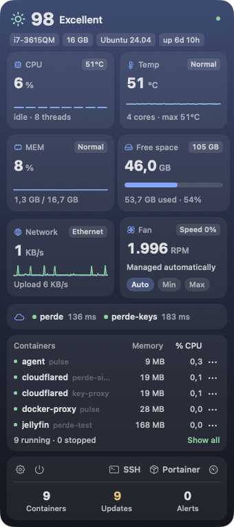
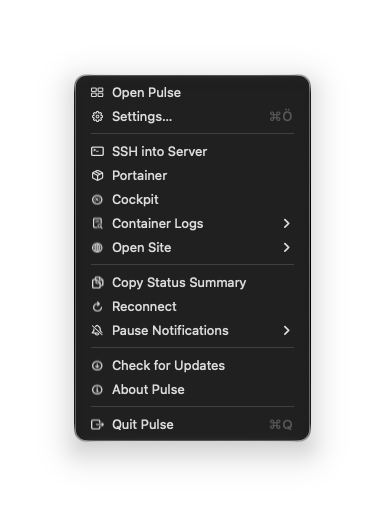
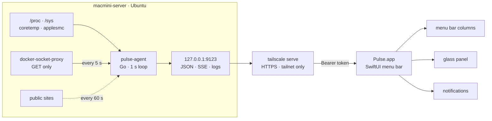

<div align="center">



<p>
  
  
  
  
</p>

<p><em>Pulse puts your home server's vital signs in the Mac menu bar: health score, CPU, temperature, memory, disk,<br>
network, fan, every Docker container and your public sites, streamed live once a second over Tailscale.</em></p>

&nbsp;&nbsp;

</div>


## Is the server all right?

I run my projects on a 2012 Mac mini with Ubuntu Server in a cupboard. It has no screen, and checking it meant SSH, `htop`, `docker ps` and opening each public site by hand. Pulse answers the question with a glance at the menu bar: a coloured dot and `TMP 49°C CPU 1% MEM 8%`. One click opens a compact frosted panel laid out like Mole's Status popover, tinted blue, with a single health score and the reasons behind it.

It has two small parts. A Go agent runs in Docker on the server and reads `/proc`, `/sys` and the Docker API. It sends a snapshot every second over Server-Sent Events. A native SwiftUI app on the Mac draws the snapshots, keeps ten minutes of chart history, and sends a notification when something needs you.

> **Nothing is exposed to the internet.** The agent listens on `127.0.0.1` only. `tailscale serve` publishes it with HTTPS inside your tailnet, so it is not on the LAN and not on Cloudflare. Docker is reached through a proxy that only allows reads, and the agent never touches the fan controller.


## Features

| | |
|---|---|
| **Health score** | 0–100 with reasons ("Security updates pending"). Resource penalties are adapted from Mole; container, site, swap and reboot penalties are added on top |
| **Menu bar** | Up to three metrics (`TMP / CPU / MEM / DSK / NET / CTR`) as stacked columns or a single line. Values turn amber or red past the thresholds |
| **Animated icon** | A little server that hops and blinks its LEDs, a running cat, or a scrolling heartbeat. All three are drawn in code, run faster as CPU load rises, and stop when the data goes stale or Reduce Motion is on |
| **Tools menu** | Right-click (or swap the clicks): open the panel, settings, SSH, Portainer, Cockpit, container logs, sites, copy a status summary, reconnect, pause notifications |
| **Settings** | General, Server, Menu Bar, Alerts and About tabs: language, launch at login, the global `⌃⌥⌘P` shortcut, menu bar content and layout, alert thresholds and event switches |
| **CPU** | Total usage, one bar per thread, load average |
| **Temperature** | `coretemp` package and per-core readings. Broken SMC sensors (-127 °C, 103 °C) are filtered out |
| **Memory** | Used = total − available, the same as `free`; swap and cache in the tooltip |
| **Disk** | Free space, usage bar, read/write rate across physical disks only |
| **Network** | Download and upload rate on the default-route interface, link speed, Mac→server latency |
| **Fan** | RPM and speed above idle from `applesmc`. Display only: `macfanctld` stays in charge |
| **Containers** | State, health, CPU share and memory for each container (as `docker stats` counts it). Failing containers sort first. Read-only log tail window |
| **Sites** | Each public URL is checked every minute and shows its response time. Two failed checks in a row raise an alert |
| **Updates** | Pending apt and security updates, and the reboot-required flag, from Ubuntu's update-notifier |
| **Notifications** | Overheating, memory, disk, failing container, site down, server unreachable, restart needed. Each has a hold time, fires once per episode, and sends a "recovered" message |
| **Quick actions** | Open SSH, Portainer or Cockpit, open container logs, copy a container name |
| **Languages** | English and Turkish (205 strings), switchable in Settings; numbers follow your locale |
| **Light on resources** | The agent uses about 8 MB RAM and under 1 % CPU on an Ivy Bridge i7. The panel's SwiftUI tree exists only while the panel is open |


## How it works



| Endpoint | What it returns |
|---|---|
| `GET /health` | `ok`, no token needed |
| `GET /v1/snapshot` | the latest snapshot as JSON |
| `GET /v1/stream` | one Server-Sent Event per second, plus a ping every 15 s |
| `GET /v1/history?range=10m\|24h` | in-memory chart history: 1 s points or 1 min averages |
| `GET /v1/containers/{id}/logs?tail=N` | the last lines of a container's logs |

The full schema, the score formula and every setting are in [`docs/API.md`](docs/API.md).

### Security, by rule

| Rule | How |
|---|---|
| No public exposure | The agent binds only `127.0.0.1`. `tailscale serve` provides HTTPS inside the tailnet. No `0.0.0.0`, no tunnel, no port forwarding |
| Docker socket is not handed out | `tecnativa/docker-socket-proxy` with `CONTAINERS=1 VERSION=1 POST=0`, bound to loopback |
| Token on every data request | Bearer token of at least 24 characters, compared in constant time. Without one the agent refuses to start |
| Locked-down containers | `read_only`, `cap_drop: ALL`, `no-new-privileges`, distroless nonroot image, 64 MB memory limit, host mounts read-only |
| No third-party Go code | The agent uses only the standard library; `govulncheck` and `staticcheck` run in CI |
| Token on the Mac | Kept in the app's sandbox container with `0600` permissions; never in logs or on the command line |


## Install

**1. Agent on the server** (from the Mac, with a Docker context pointing at the server):

```bash
./deploy/deploy.sh             # creates deploy/.env with a fresh token, builds on the server,
                               # starts agent + proxy, runs `tailscale serve`, verifies 401 and 200
./deploy/deploy.sh --copy-token  # copies the token to the clipboard (never printed)
```

Edit `deploy/.env` to set the sites to check: `PULSE_PROBES=name=https://…,name=https://…`.

**2. App on the Mac:**

```bash
./scripts/release-macos.sh --install   # tests, Release build, DMG in dist/, installs to /Applications
pbpaste | /Applications/Pulse.app/Contents/MacOS/Pulse --configure server.tailnet.ts.net:9123 --ssh user@server --login
```

You can also open Pulse and paste the address and token in Settings. Builds are ad-hoc signed, so on another Mac the first launch needs right-click → Open.


## Türkçe özet

Pulse, evdeki Ubuntu sunucusunu Mac'in menü çubuğundan canlı izler: sağlık puanı, işlemci, sıcaklık, bellek, disk, ağ, fan, Docker konteynerleri ve yayındaki siteler saniyede bir güncellenir. Sunucuda yalnız standart kütüphaneyle yazılmış küçük bir Go ajanı Docker'da çalışır. Mac'te SwiftUI ile yazılmış, Mole'un Status paneliyle aynı düzende, mavi tonlu buğulu bir panel açılır. Ajan internete açılmaz: yalnız `127.0.0.1`'i dinler, `tailscale serve` ile yalnız senin Tailscale ağından erişilir ve her istek bir token ister. Docker'a yalnız okuma izni veren bir aracı (socket proxy) üzerinden bağlanır, fana dokunmaz. Konteyner bozulursa, sunucu ısınırsa, site düşerse ya da sunucuya ulaşılamazsa bildirim gelir; düzelince de haber verir. Menü çubuğunda zıplayan bir sunucu, koşan bir kedi ya da kayan bir nabız çizgisi seçilebilir; sağ tık araç menüsünü, ayarlar da Genel, Sunucu, Menü çubuğu, Uyarılar ve Hakkında sekmelerini açar.


## Development

```bash
cd agent && go test -race ./... && go vet ./...     # 30 Go tests against real /proc and /sys fixtures
cd agent && go run ./cmd/pulse-agent --once        # one snapshot of this machine (Linux; DOCKER_HOST=off skips Docker)
cd app/Packages/PulseKit && swift test             # 23 Swift tests: schema, formatting, alerts, SSE, menu bar
cd app && xcodegen generate && swiftlint lint --strict
python3 scripts/l10n.py app/Packages/PulseKit/l10n/tr.json   # rebuild the string catalog after adding L("…")
swift scripts/make-icon.swift                      # redraw the app icon
```

Agent environment: `PULSE_LISTEN`, `PULSE_TOKEN`, `PULSE_NO_AUTH` (loopback only), `PULSE_HOST_PROC`, `PULSE_HOST_SYS`, `PULSE_HOST_ROOT`, `DOCKER_HOST`, `PULSE_PROBES`, `PULSE_NET_IFACE`.

```
agent/                 Go agent (stdlib only)
  internal/collect/    procfs and sysfs readers: CPU, memory, disk, network, thermal, fan, apt
  internal/docker/     read-only Engine API client, log demux
  internal/health/     health score (adapted from Mole)
  internal/api/        HTTP, SSE, auth
  testdata/macmini/    recorded /proc and /sys of the real server
deploy/                compose.yaml (agent + socket proxy), deploy.sh
app/                   XcodeGen project, menu bar app shell
  Packages/PulseKit/   PulseCore (models, alerts) · PulseClient (SSE) · PulseUI (panel, settings)
docs/                  PLAN.md, API.md, design/
scripts/               release-macos.sh, make-icon.swift, l10n.py
```

<br>

<a href="https://github.com/kutluhangil"></a>

<sub>GPL-3.0. The health score's resource penalties are adapted from <a href="https://github.com/tw93/Mole">Mole</a> by tw93 (GPL-3.0), and the panel layout is inspired by Mole for Mac's Status view. The banner's values and container names are examples. The panel screenshot is the real server.</sub>
